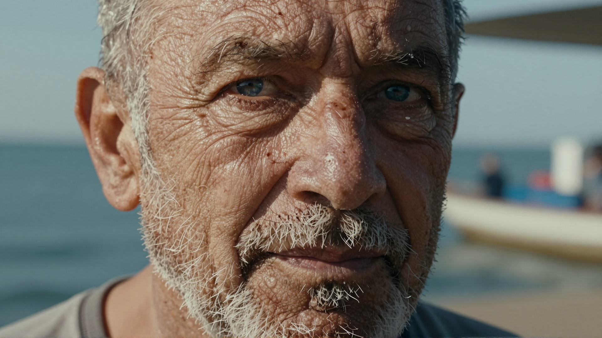
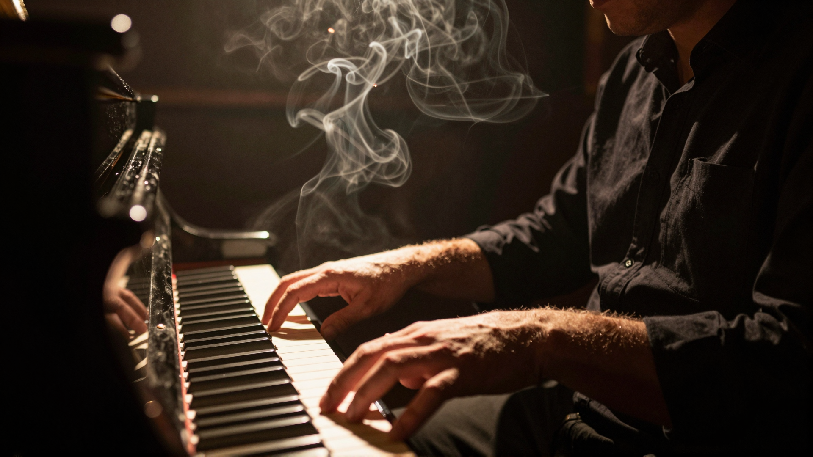
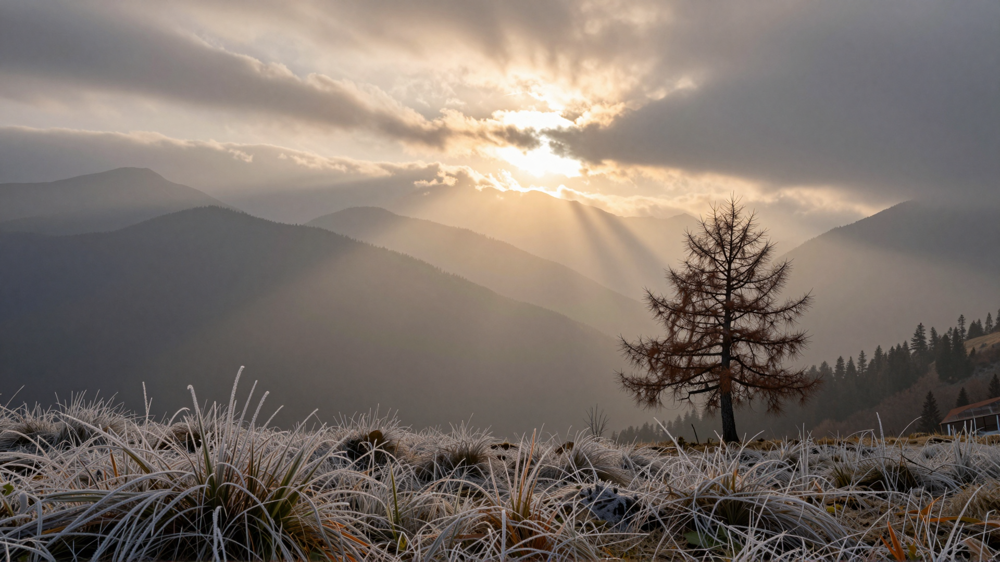
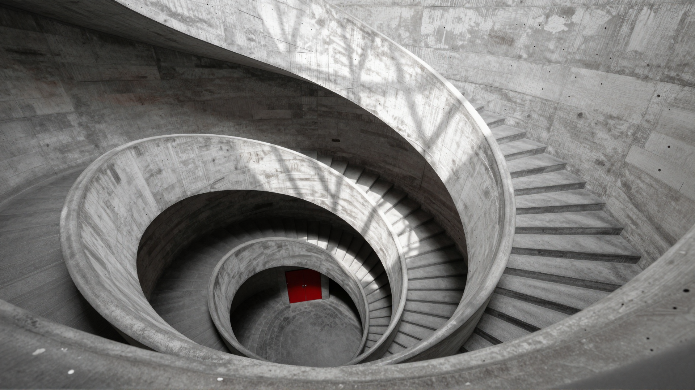
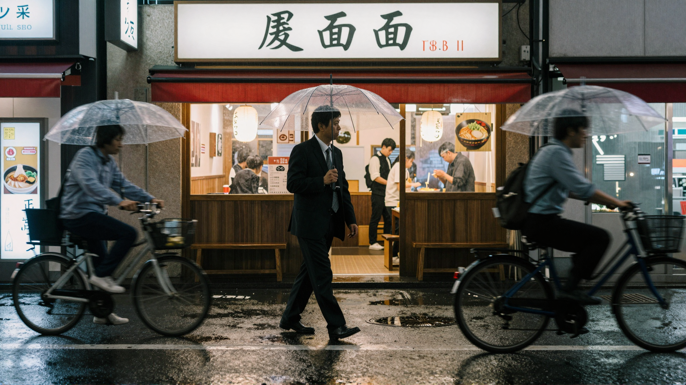
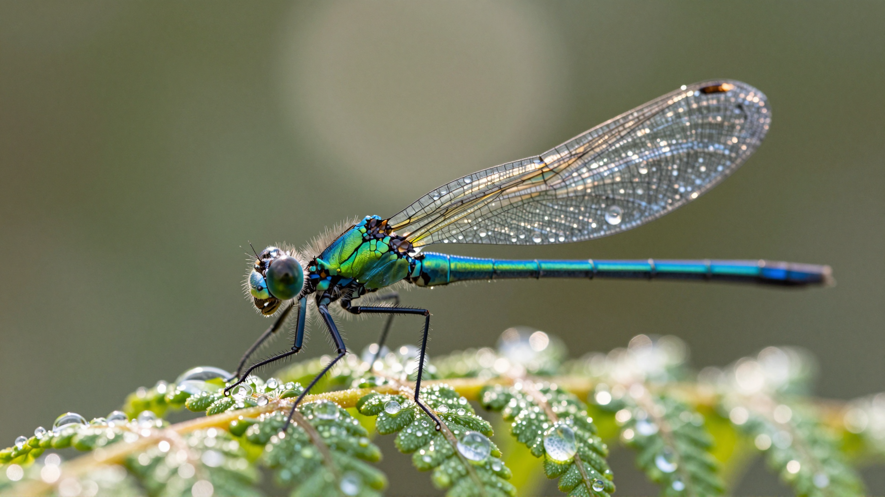
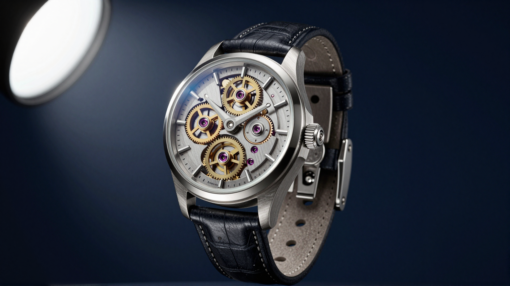
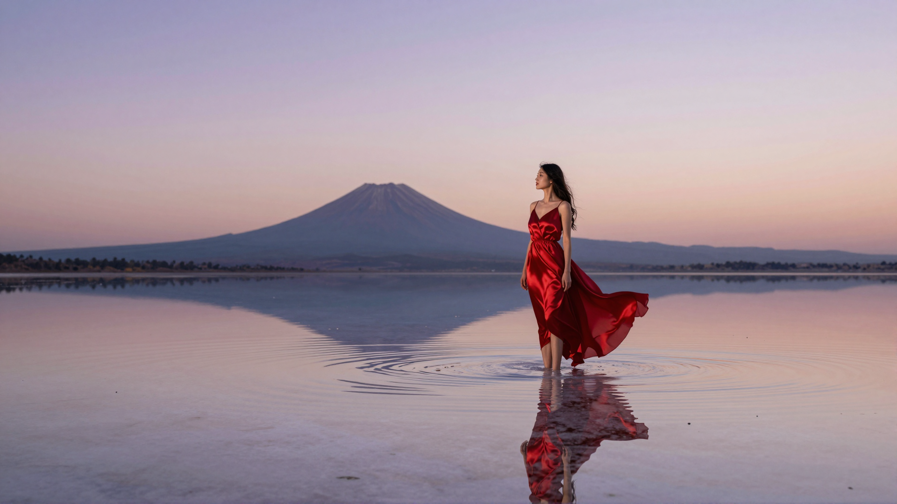
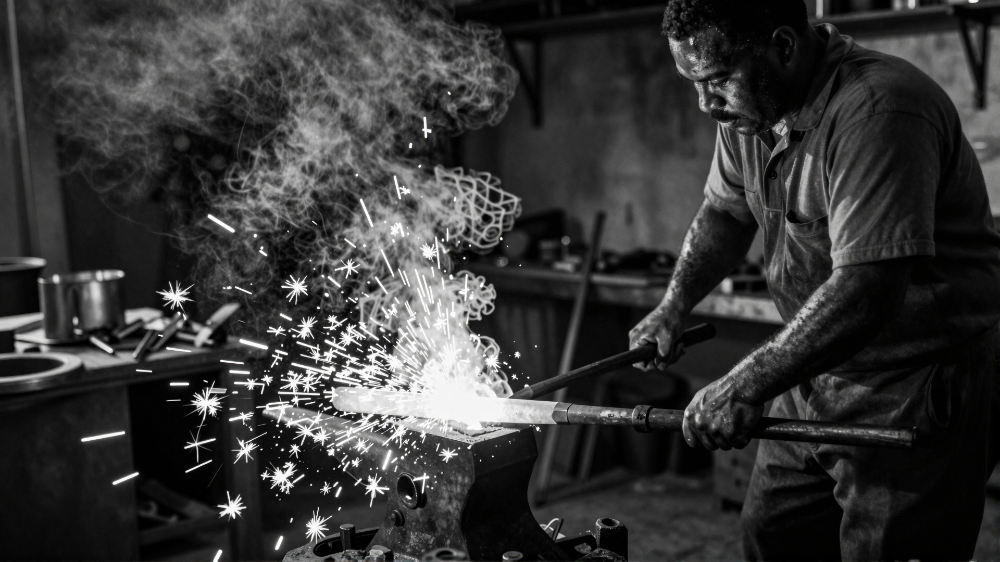
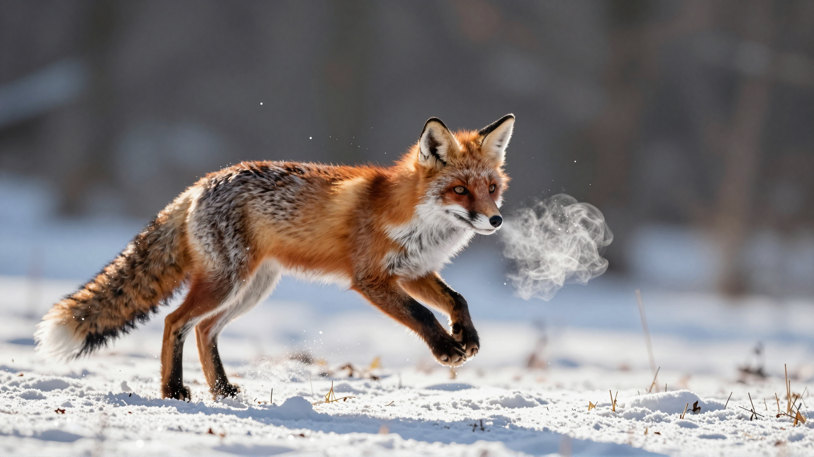

# Z-Image Turbo Model & Workflow Tests für Fotografen

**Kurzbeschreibung:**
Dieses Dokument beschreibt das Modell **Z-Image Turbo** und die durchgeführten Workflow-Tests mit ComfyUI, die sich an Fotografen richten. Zehn Fotografie-Prompts wurden über einen lokalen ComfyUI-Server generiert; die Ergebnisse liegen im Ordner `output_images_zimage` (Details: `ZIMAGE-Workflow.md`).

## Modellübersicht
- Name: `z_image_turbo_bf16.safetensors` (Z-Image Turbo)
- Text-Encoder: `qwen_3_4b.safetensors` (CLIP-Typ `lumina2`), VAE: `ae.safetensors`
- Zweck: Bild- und Fotostil-Generierung mit Fokus auf fotografische Parameter (Brennweite, Blende, Filmlook, Beleuchtung).
- Typ: Text-zu-Bild, Turbo-Modell mit nur 9 Steps und CFG 1.

## Workflow (Kurz)
1. Prompt formulieren: fotografische Beschreibung + Stil + Stimmung.
2. Workflow `z_image_turbo.json` (API-Format) wird mit Prompt und zufälligem Seed an ComfyUI geschickt.
3. Sampler-Settings: `res_multistep` / `simple`, 9 Steps, CFG 1, Shift 3, Auflösung 1920 × 1080.
4. Bilder werden nach `output_images_zimage/` geladen, daneben eine `.txt` mit allen Parametern.

## Dokumentation der Testläufe
Die folgenden Einträge dokumentieren jeweils: Dateiname, kurze Beschreibung, verwendeter Prompt, Einstellungen und das generierte Bild.

### 01_fisherman_portrait_00.png
- Beschreibung: Dokumentarisches Close-up-Portrait eines älteren Fischers, harte Mittagssonne, sichtbare Hautporen, leichter Filmkorn.
- Prompt:
```
A close-up documentary portrait of an elderly fisherman, weathered skin with visible pores and deep wrinkles, salt-crusted grey beard, piercing blue eyes, harsh midday sunlight creating dramatic shadows, subsurface scattering on skin, natural skin oil and imperfections, shot on Kodak Portra 400, Hasselblad H6D with 80mm lens at f/2.8, unretouched photojournalism, slight film grain
```
- Einstellungen:
  - Sampler: `res_multistep` | Scheduler: `simple`
  - Steps: `9` | CFG: `1` | Denoise: `1` | Shift: `3`
  - Seed: `938939341077640324`
  - Auflösung: `1920 × 1080` | Dauer: `24.6s`
- Output: 

### 02_jazz_pianist_lowlight_00.png
- Beschreibung: Pianist in gedimmtem Jazz-Club, einzelner Tungsten-Spot, Rauch im Lichtstrahl, Low-Light.
- Prompt:
```
A jazz pianist performing in a dimly lit underground club, single warm tungsten spotlight illuminating hands and keys, deep shadows, cigarette smoke drifting through the light beam, shot on Leica M11 with 50mm Summilux at f/1.4, ISO 3200, slight grain, Saul Leiter-inspired mood
```
- Einstellungen:
  - Sampler: `res_multistep` | Scheduler: `simple`
  - Steps: `9` | CFG: `1` | Denoise: `1` | Shift: `3`
  - Seed: `4025868854565487364`
  - Auflösung: `1920 × 1080` | Dauer: `19.5s`
- Output: 

### 03_alpine_sunrise_00.png
- Beschreibung: Nebliges Alpental bei Sonnenaufgang, Lichtstrahl auf einer Lärche, große Tiefenschärfe.
- Prompt:
```
Misty alpine valley at sunrise, layered mountain ridges fading into atmospheric haze, single shaft of golden light breaking through clouds onto a lone larch tree, frost on grass in foreground, shot on Phase One IQ4 150MP, 45mm lens, f/11, ultra-sharp foreground to infinity, large format detail
```
- Einstellungen:
  - Sampler: `res_multistep` | Scheduler: `simple`
  - Steps: `9` | CFG: `1` | Denoise: `1` | Shift: `3`
  - Seed: `2075191431068272444`
  - Auflösung: `1920 × 1080` | Dauer: `17.3s`
- Output: 

### 04_brutalist_architecture_00.png
- Beschreibung: Brutalistische Betontreppe von oben, geometrische Schatten, eine rote Tür als Farbakzent.
- Prompt:
```
Brutalist concrete staircase spiraling downward, geometric shadows from a single overhead skylight, monochromatic gray palette with one red door at the bottom, symmetrical composition, shot on Fujifilm GFX 100S, 23mm tilt-shift lens, architectural photography style reminiscent of Hélène Binet
```
- Einstellungen:
  - Sampler: `res_multistep` | Scheduler: `simple`
  - Steps: `9` | CFG: `1` | Denoise: `1` | Shift: `3`
  - Seed: `914856642434662987`
  - Auflösung: `1920 × 1080` | Dauer: `23.3s`
- Output: 

### 05_tokyo_street_rain_00.png
- Beschreibung: Regennacht in Shinjuku, Neon-Reflexe auf nassem Asphalt, Bewegungsunschärfe.
- Prompt:
```
Tokyo rainy night in Shinjuku, neon reflections in wet asphalt, lone businessman with transparent umbrella walking past a ramen shop, motion blur on passing cyclist, shot on Ricoh GR III, 28mm, f/2.8, 1/30s, candid moment, Daido Moriyama atmosphere
```
- Einstellungen:
  - Sampler: `res_multistep` | Scheduler: `simple`
  - Steps: `9` | CFG: `1` | Denoise: `1` | Shift: `3`
  - Seed: `2752714224073625166`
  - Auflösung: `1920 × 1080` | Dauer: `19.4s`
- Output: 

### 06_damselfly_macro_00.png
- Beschreibung: Extremes Makro einer Libelle auf taubedecktem Farn, cremiges Bokeh.
- Prompt:
```
Extreme macro of a damselfly perched on a dewdrop-covered fern, iridescent wings catching morning light, shallow depth of field with creamy bokeh, water droplets acting as tiny lenses, shot on Canon EOS R5 with MP-E 65mm at 3x magnification, f/8, focus stacked, scientific clarity
```
- Einstellungen:
  - Sampler: `res_multistep` | Scheduler: `simple`
  - Steps: `9` | CFG: `1` | Denoise: `1` | Shift: `3`
  - Seed: `4817398244941243033`
  - Auflösung: `1920 × 1080` | Dauer: `20.8s`
- Output: 

### 07_watch_product_00.png
- Beschreibung: Produktfoto einer Vintage-Armbanduhr vor dunkelblauem Hintergrund, Chiaroscuro-Licht.
- Prompt:
```
A vintage mechanical wristwatch floating against a deep navy background, dramatic chiaroscuro lighting from a single softbox at 45 degrees, exposed gears and jewels visible through sapphire crystal, microscopic dust particles, shot on Sony A1 with 90mm macro at f/11, commercial product photography
```
- Einstellungen:
  - Sampler: `res_multistep` | Scheduler: `simple`
  - Steps: `9` | CFG: `1` | Denoise: `1` | Shift: `3`
  - Seed: `2663673273776059416`
  - Auflösung: `1920 × 1080` | Dauer: `19.4s`
- Output: 

### 08_salt_lake_surreal_00.png
- Beschreibung: Surreale Szene: Frau in rotem Seidenkleid im spiegelglatten Salzsee in der Dämmerung.
- Prompt:
```
A woman in a flowing red silk dress standing knee-deep in a mirror-still salt lake at twilight, perfect reflection doubling her form, distant volcano on horizon, dreamlike pastel sky transitioning from lavender to peach, shot on medium format film, Tim Walker editorial style
```
- Einstellungen:
  - Sampler: `res_multistep` | Scheduler: `simple`
  - Steps: `9` | CFG: `1` | Denoise: `1` | Shift: `3`
  - Seed: `6015654066147907265`
  - Auflösung: `1920 × 1080` | Dauer: `20.1s`
- Output: 

### 09_blacksmith_bw_00.png
- Beschreibung: Schwarzweiß-Dokumentarfoto eines Schmieds beim Schlag, Funkenflug, hartes Feuerlicht.
- Prompt:
```
Black and white documentary photograph of a blacksmith mid-strike, sparks flying from glowing orange metal, smoke and soot in the air, deeply contrasted lighting from forge fire, sweat-glistened arms, shot on Tri-X 400 pushed to 1600, Leica M6 with 35mm Summicron, Sebastião Salgado aesthetic
```
- Einstellungen:
  - Sampler: `res_multistep` | Scheduler: `simple`
  - Steps: `9` | CFG: `1` | Denoise: `1` | Shift: `3`
  - Seed: `4500023523675095555`
  - Auflösung: `1920 × 1080` | Dauer: `18.8s`
- Output: 

### 10_fox_action_00.png
- Beschreibung: Actionaufnahme eines springenden Fuchses im Schnee, Gegenlicht mit Rim-Light.
- Prompt:
```
A red fox leaping mid-air across a snow-covered meadow, snow crystals suspended in the air around its paws, breath visible as vapor, bright winter sun backlighting the scene creating a rim light on fur, shot on Nikon Z9 with 600mm f/4 at 1/2000s, wildlife photography, tack sharp on the eyes
```
- Einstellungen:
  - Sampler: `res_multistep` | Scheduler: `simple`
  - Steps: `9` | CFG: `1` | Denoise: `1` | Shift: `3`
  - Seed: `764497505290907326`
  - Auflösung: `1920 × 1080` | Dauer: `17.5s`
- Output: 

## Hinweise zur Reproduktion
- Jede Bild-`.txt` enthält den verwendeten `Seed`. Setze ihn im `KSampler` (Node `10`) fest, um das Bild exakt zu reproduzieren.
- Turbo-Modelle brauchen kein hohes CFG; CFG `1` ist beabsichtigt.

## Vorschläge für Fotografen
- Testen Sie unterschiedliche Brennweiten/Blenden im Prompt, um gewünschte Bokeh- und Tiefenwirkung zu erzielen.
- Verwenden Sie Film- oder Kameramodell-Keywords (z. B. "Kodak Portra", "Leica M"), um spezifische Looks zu favorisieren.
